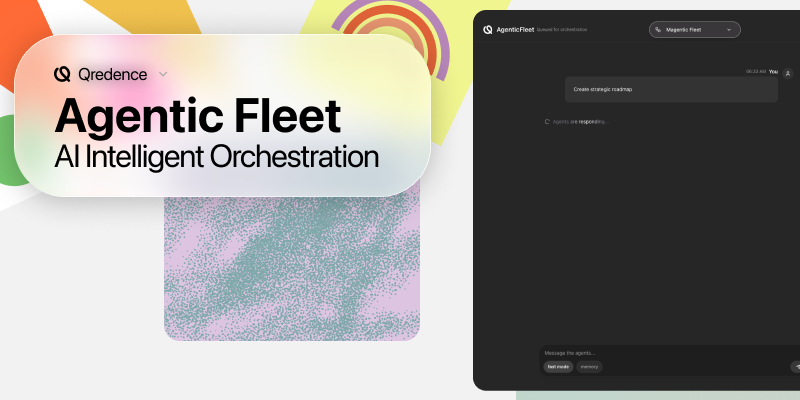

# AgenticFleet

<p align="center">
  
</p>

<p align="center">
  <a href="./LICENSE"></a>
  <a href="https://pypi.org/project/agentic-fleet/"></a>
  <a href="https://pypi.org/project/agentic-fleet/"></a>
  <a href="https://pepy.tech/projects/agentic-fleet"></a>
  <a href="https://deepwiki.com/qredence/agentic-fleet"></a>
  <a href="https://coderabbit.ai"></a>
</p>

<p align="center"><b>Self-optimizing multi-agent orchestration powered by DSPy + Microsoft Agent Framework.</b></p>

---

## Project Name and Description

**AgenticFleet** is a production-ready multi-agent orchestration runtime that routes tasks to specialized agents through a five-phase pipeline (analysis → routing → execution → progress → quality). It combines DSPy for structured reasoning with the Microsoft Agent Framework for reliable execution, streaming rich events to both CLI and web clients.

## 🛠️ Technology Stack

- **Backend:** Python 3.12 / 3.13, FastAPI, Typer CLI, [DSPy](https://github.com/stanfordnlp/dspy), [Microsoft Agent Framework](https://github.com/microsoft/agent-framework) (Magentic Fleet pattern), Pydantic v2
- **Package Manager:** [uv](https://github.com/astral-sh/uv) (Python), [npm](https://www.npmjs.com/) (Frontend)
- **Orchestration & Tools:** ToolRegistry adapters (Tavily search, browser automation, code execution, MCP), offline-compiled DSPy modules
- **Frontend:** React 19, TypeScript, Vite, Tailwind CSS, Radix UI, Shadcn UI, Lucide Icons; real-time SSE/WebSocket streaming
- **Infrastructure & Storage:** Azure Cosmos DB (primary store), SQLite/local persistence, Docker + Docker Compose
- **Observability & Evaluation:** OpenTelemetry (Jaeger, Azure Monitor), Azure AI Evaluation, Langfuse; retries via Tenacity; async concurrency with AnyIO/Asyncer

## 📋 Requirements

- **Python:** 3.12 or 3.13
- **Dependency Manager:** [uv](https://github.com/astral-sh/uv)
- **Node.js:** 18+ (for the frontend)
- **API Keys:** OpenAI API Key (required), Tavily API Key (optional, for web search)
- **Optional:** Docker + Docker Compose, Azure credentials for Cosmos/monitoring

## 🚀 Getting Started

### Installation

```bash
# Clone the repository
git clone https://github.com/Qredence/agentic-fleet.git
cd agentic-fleet

# Full development setup (Python + Frontend + Pre-commit)
make dev-setup

# Or individual steps:
# make install            # Python deps via uv
# make frontend-install   # Frontend deps via npm

# Configure environment
cp .env.example .env
# Set OPENAI_API_KEY and other variables in .env
```

### Run Commands

```bash
# Full stack development (backend + frontend)
make dev

# Backend only (port 8000)
make backend

# Frontend only (port 5173)
make frontend-dev

# Interactive CLI console
make run

# Single task via CLI
uv run agentic-fleet run -m "Research the latest advances in AI agents" --verbose
```

## 📜 Scripts

The project uses a `Makefile` to centralize development commands:

| Command              | Description                                              |
| :------------------- | :------------------------------------------------------- |
| `make install`       | Install/sync Python dependencies via `uv`                |
| `make dev-setup`     | Full development setup (install + frontend + pre-commit) |
| `make dev`           | Run backend + frontend together (full stack)             |
| `make backend`       | Run backend only (port 8000)                             |
| `make frontend-dev`  | Run frontend only (port 5173)                            |
| `make test`          | Run backend tests (fast)                                 |
| `make test-all`      | Run all tests (backend + frontend)                       |
| `make check`         | Quick quality check (lint + type-check)                  |
| `make qa`            | Full QA suite (lint + format + type + all tests)         |
| `make format`        | Format backend code with Ruff                            |
| `make lint`          | Run Ruff linter on backend                               |
| `make type-check`    | Run `ty` type checker                                    |
| `make clear-cache`   | Clear compiled DSPy cache                                |
| `make tracing-start` | Start OpenTelemetry collector + Jaeger UI                |
| `make tracing-stop`  | Stop the tracing collector                               |

## 🔑 Environment Variables

Key variables from `.env.example`:

| Variable                  | Description                                | Required           |
| :------------------------ | :----------------------------------------- | :----------------- |
| `OPENAI_API_KEY`          | OpenAI API key                             | Yes                |
| `TAVILY_API_KEY`          | Tavily API key for web search              | No (Recommended)   |
| `PROJECT_PATH`            | Local path to agentic-fleet repo (for MCP) | No                 |
| `DSPY_COMPILE`            | Enable DSPy supervisor compilation         | No (Default: true) |
| `AZURE_OPENAI_*`          | Azure OpenAI configuration                 | No                 |
| `AGENTICFLEET_USE_COSMOS` | Enable Azure Cosmos DB integration         | No                 |
| `ENABLE_OTEL`             | Enable OpenTelemetry tracing               | No                 |
| `LANGFUSE_*`              | Langfuse tracing keys                      | No                 |

## 🧪 Testing

We use **pytest** for backend testing and **vitest** (via npm) for frontend.

```bash
# Run all backend tests
make test

# Run all tests (Backend + Frontend)
make test-all

# Specific test suite
uv run pytest tests/workflows/test_supervisor_workflow.py

# With coverage
uv run pytest --cov=src --cov-report=term-missing tests/
```

## 📂 Project Structure

```
.
├── src/
│   ├── agentic_fleet/    # Backend source code
│   │   ├── workflows/    # SupervisorWorkflow and execution phases
│   │   ├── agents/       # Agent definitions and Factory
│   │   ├── tools/        # Tool adapters (Tavily, Browser, MCP)
│   │   ├── dspy_modules/ # DSPy signatures and reasoner
│   │   ├── api/          # FastAPI routes and services
│   │   ├── config/       # YAML configurations
│   │   ├── utils/        # Infra, storage, and config utilities
│   │   └── cli/          # Typer CLI implementation
│   └── frontend/         # React 19 + Vite + Tailwind UI
├── tests/                # Pytest suites (unit, integration)
├── scripts/              # Helper scripts and benchmarks
├── docs/                 # Detailed documentation
├── .var/                 # Runtime artifacts (logs, caches) - gitignored
├── pyproject.toml        # Python project metadata and dependencies
└── Makefile              # Development command shortcuts
```

## 📄 License

This project is licensed under the **MIT License**. See [LICENSE](LICENSE) for details.

---

Helpful links: [Copilot instructions](.github/copilot-instructions.md) · [prompts](.github/prompts/README.md) · [system overview](docs/developers/system-overview.md)

## ✨ What is AgenticFleet?

AgenticFleet is a production-oriented multi-agent orchestration system that **automatically routes tasks to specialized AI agents** and orchestrates their execution through a self-optimizing 5-phase pipeline.

### The 5-Phase Pipeline

Every task flows through intelligent orchestration:

```
┌─────────┐    ┌─────────┐    ┌───────────┐    ┌──────────┐    ┌─────────┐
│ANALYSIS │───►│ ROUTING │───►│ EXECUTION │───►│ PROGRESS │───►│ QUALITY │
│         │    │         │    │           │    │          │    │         │
│Complexity│    │Agent(s) │    │Delegated/ │    │Complete? │    │Score    │
│Skills    │    │Mode     │    │Sequential/│    │Refine?   │    │0-10     │
│Tools     │    │Subtasks │    │Parallel   │    │Continue? │    │Feedback │
└─────────┘    └─────────┘    └───────────┘    └──────────┘    └─────────┘
```

**How it works:**

1. **Analysis** – DSPy analyzes task complexity, required skills, and recommended tools
2. **Routing** – Intelligent selection of agents and execution mode based on learned patterns
3. **Execution** – Agents work in parallel, sequence, or delegation with tool access
4. **Progress** – Evaluates if task is complete or needs refinement
5. **Quality** – Scores output (0-10) and identifies missing elements

### Key Features

- 🧠 **DSPy-Powered Intelligence** – Typed signatures with Pydantic validation for reliable structured outputs
- 🔄 **6 Execution Modes** – Auto, Delegated, Sequential, Parallel, Handoff, and Discussion
- 🎯 **9+ Specialized Agents** – Researcher, Analyst, Writer, Reviewer, Coder, Planner, Executor, Verifier, Generator
- ⚡ **Smart Fast-Path** – Simple queries bypass multi-agent routing (<1s response)
- 🛠️ **Tool Integration** – Web search (Tavily), code execution, browser automation, MCP tools
- 🧍 **Human-in-the-Loop (HITL)** – Request/response events can pause execution until the user responds
- ♻️ **Checkpoint Resume** – Resume interrupted runs using agent-framework checkpoint semantics
- 📈 **Self-Improvement** – Learns from execution history to improve routing decisions
- 📊 **Built-in Evaluation** – Azure AI Evaluation integration for quality metrics
- 🔍 **OpenTelemetry Tracing** – Full observability with Jaeger and Azure Monitor export

## 🚀 Quick Start

### Installation

```bash
# Clone and install
git clone https://github.com/Qredence/agentic-fleet.git && cd agentic-fleet
make install            # installs Python deps via uv
make frontend-install   # installs frontend deps via npm

# Configure environment
cp .env.example .env
# Set OPENAI_API_KEY (required)
# Set TAVILY_API_KEY (optional, enables web search)
```

### Run

```bash
# Interactive CLI
make run

# Single task
agentic-fleet run -m "Research the latest advances in AI agents" --verbose

# Development server (backend + frontend)
make dev
```

## 📖 Usage

### CLI

```bash
agentic-fleet                              # Interactive console
agentic-fleet run -m "Your task"           # Execute a task
agentic-fleet run -m "Query" --mode handoff  # Specific execution mode
agentic-fleet list-agents                  # Show available agents
agentic-fleet dev                          # Start dev servers
```

### Python API

```python
import asyncio
from agentic_fleet.workflows import create_supervisor_workflow

async def main():
    workflow = await create_supervisor_workflow()
    result = await workflow.run("Summarize the transformer architecture")
    print(result["result"])

asyncio.run(main())
```

### Web Interface

```bash
agentic-fleet dev  # Backend: http://localhost:8000, Frontend: http://localhost:5173
```

The web interface provides:

- Real-time streaming responses with workflow visualization
- Conversation history with persistence
- Agent activity display and orchestration insights

Notes:

- The **fast-path** is intended for first-turn/simple prompts; follow-up turns in an existing conversation are routed through the full workflow so history is respected.
- For advanced streaming semantics (HITL responses and checkpoint resume), see the [Frontend Guide](docs/users/frontend.md#websocket-protocol).

## 🤖 Agents & Execution Modes

### Specialized Agents

| Agent          | Expertise                                           |
| -------------- | --------------------------------------------------- |
| **Researcher** | Web search, information gathering, source synthesis |
| **Analyst**    | Data analysis, code review, technical evaluation    |
| **Writer**     | Content creation, documentation, summarization      |
| **Reviewer**   | Quality assurance, fact-checking, critique          |
| **Coder**      | Code generation, debugging, implementation          |
| **Planner**    | Task decomposition, strategy, coordination          |
| **Executor**   | Task execution and action coordination              |
| **Verifier**   | Output validation and correctness checking          |
| **Generator**  | Creative content and ideation                       |

### Execution Modes

| Mode           | Description                         | Best For             |
| -------------- | ----------------------------------- | -------------------- |
| **Auto**       | DSPy selects optimal mode (default) | Most tasks           |
| **Delegated**  | Single agent handles entire task    | Focused work         |
| **Sequential** | Agents work in pipeline             | Multi-step tasks     |
| **Parallel**   | Concurrent agent execution          | Independent subtasks |
| **Handoff**    | Direct agent-to-agent transfers     | Specialized chains   |
| **Discussion** | Multi-agent group chat              | Complex problems     |

## ⚙️ Configuration

### Environment Variables

```bash
# Required
OPENAI_API_KEY=sk-...

# Optional
TAVILY_API_KEY=tvly-...              # Web search capability
DSPY_COMPILE=true                    # Enable DSPy optimization
ENABLE_OTEL=true                     # OpenTelemetry tracing
OTLP_ENDPOINT=http://...             # Tracing endpoint
ENABLE_SENSITIVE_DATA=true           # Capture prompts in traces/telemetry (default: false)
AGENTICFLEET_USE_COSMOS=true         # Enable Azure Cosmos DB integration
AGENTICFLEET_DEFAULT_USER_ID=user123 # Default user ID for multi-tenant scoping
```

### Workflow Configuration

All runtime settings are in `src/agentic_fleet/config/workflow_config.yaml`:

```yaml
dspy:
  model: gpt-5.2 # Primary model for DSPy tasks
  routing_model: gpt-5-mini # Fast model for routing decisions
  use_typed_signatures: true # Pydantic-validated outputs
  enable_routing_cache: true # Cache routing decisions
  routing_cache_ttl_seconds: 300 # Cache TTL (5 minutes)

workflow:
  supervisor:
    max_rounds: 15
    enable_streaming: true
  quality:
    refinement_threshold: 8.0
    enable_refinement: false # Disabled for speed

agents:
  researcher:
    model: gpt-4.1-mini
    tools: [TavilySearchTool]
  coder:
    model: gpt-5.1-codex-mini
    tools: [HostedCodeInterpreterTool]
```

## 🏗️ Architecture

### Optional keyless web search

To opt in to [Parallel Search MCP](https://docs.parallel.ai/integrations/mcp/search-mcp),
replace `TavilySearchTool` with `ParallelSearchMCPTool` in your researcher tool list
in `src/agentic_fleet/config/workflow_config.yaml`:

```yaml
agents:
  researcher:
    tools: [ParallelSearchMCPTool]
```

Keep the other researcher settings. The factory loads `web_search` (source URLs
and excerpts) and `web_fetch` (page extraction) through Streamable HTTP at
`https://search.parallel.ai/mcp`. No Parallel API key is needed or read; anonymous
access is free for light use with lower rate limits. Model inference still needs
your configured model credentials. The shipped tool selection remains Tavily.

After the normal `uv sync` installation, you can also search directly through
the registry without model credentials:

```python
import asyncio

from agentic_fleet.tools import ParallelSearchMCPTool
from agentic_fleet.utils.tool_registry import ToolRegistry


async def main():
    registry = ToolRegistry()
    registry.register_tool_by_agent("researcher", ParallelSearchMCPTool())
    result = await registry.execute_tool(
        "parallel_search",
        query="Find the Python asyncio documentation",
        search_queries=["Python asyncio documentation"],
    )
    print(result)


asyncio.run(main())
```

### System Overview

```
┌─────────────────────────────────────────────────────────────────────────────┐
│                              Entry Points                                    │
│    ┌─────────┐         ┌─────────┐         ┌─────────────────────────┐      │
│    │   CLI   │         │ Web UI  │         │      Python API         │      │
│    │ (Typer) │         │ (React) │         │ create_supervisor_      │      │
│    │         │         │         │         │ workflow()              │      │
│    └────┬────┘         └────┬────┘         └───────────┬─────────────┘      │
│         └──────────────────┬┴──────────────────────────┘                    │
│                            │                                                │
│                   ┌────────▼────────┐                                       │
│                   │ SupervisorWorkflow │ ◄── 5-Phase Pipeline               │
│                   └────────┬────────┘                                       │
│         ┌──────────────────┼──────────────────┐                             │
│         │                  │                  │                             │
│  ┌──────▼──────┐   ┌───────▼───────┐  ┌──────▼──────┐                       │
│  │DSPyReasoner │   │  AgentFactory │  │ ToolRegistry│                       │
│  │ (Analysis,  │   │ (Creates      │  │ (Tavily,    │                       │
│  │  Routing,   │   │  Specialized  │  │  Code, MCP) │                       │
│  │  Quality)   │   │  Agents)      │  │             │                       │
│  └─────────────┘   └───────────────┘  └─────────────┘                       │
└─────────────────────────────────────────────────────────────────────────────┘
```

### Directory Structure

```
src/agentic_fleet/
├── workflows/        # Orchestration: supervisor.py (entry), executors/ (5 phases)
│   ├── supervisor.py # Main workflow entry + fast-path detection
│   ├── executors.py  # AnalysisExecutor, RoutingExecutor, ExecutionExecutor, etc.
│   └── strategies.py # Execution modes (delegated/sequential/parallel)
├── dspy_modules/     # DSPy intelligence layer
│   ├── reasoner.py   # DSPyReasoner (orchestrates all DSPy modules)
│   ├── signatures.py # TaskAnalysis, TaskRouting, QualityAssessment
│   ├── typed_models.py # Pydantic output models
│   └── assertions.py # DSPy assertions for validation
├── agents/           # Agent definitions & AgentFactory (coordinator.py)
├── tools/            # Tavily, browser, MCP bridges, code interpreter
├── api/              # FastAPI backend, WebSocket/SSE streaming
├── config/           # workflow_config.yaml (source of truth)
├── utils/            # Organized into subpackages:
│   ├── cfg/          # Configuration loading
│   ├── infra/        # Tracing, resilience, telemetry
│   └── storage/      # Cosmos DB, history, persistence
└── cli/              # Typer CLI commands

src/frontend/         # React 19 + Vite + Tailwind UI
```

### Key Design Principles

1. **Config-Driven** – All models, agents, and thresholds in `workflow_config.yaml`
2. **Offline Compilation** – DSPy modules compiled offline, never at runtime in production
3. **Type Safety** – Pydantic models for all DSPy outputs (typed signatures)
4. **Assertion-Driven** – DSPy assertions validate routing decisions
5. **Self-Improving** – Learns from execution history via BridgeMiddleware

## 🧪 Development

```bash
make install           # Install dependencies
make dev               # Run backend + frontend
make test              # Run tests
make check             # Lint + type-check (run before committing)
make clear-cache       # Clear DSPy cache after module changes
```

## 📚 Documentation

### For Users

| Guide                                            | Description                                       |
| ------------------------------------------------ | ------------------------------------------------- |
| [Getting Started](docs/users/getting-started.md) | Installation, "Hello World", progressive examples |
| [Overview](docs/users/overview.md)               | What AgenticFleet is and how it works             |
| [User Guide](docs/users/user-guide.md)           | Complete usage guide and features                 |
| [Configuration](docs/users/configuration.md)     | Environment and workflow config                   |
| [Frontend Guide](docs/users/frontend.md)         | Web interface and WebSocket protocol              |
| [Troubleshooting](docs/users/troubleshooting.md) | Common issues and solutions                       |

### For Developers

| Guide                                                               | Description                                      |
| ------------------------------------------------------------------- | ------------------------------------------------ |
| [System Overview](docs/developers/system-overview.md)               | **Comprehensive technical guide** (1,150+ lines) |
| [Architecture](docs/developers/architecture.md)                     | System design, diagrams, and data flow           |
| [API Reference](docs/developers/api-reference.md)                   | Core classes, methods, and types                 |
| [DSPy Integration](docs/guides/dspy-agent-framework-integration.md) | DSPy + Agent Framework patterns                  |
| [Tracing](docs/guides/tracing.md)                                   | OpenTelemetry and Jaeger setup                   |
| [Contributing](docs/developers/contributing.md)                     | Development guidelines                           |

## 🆕 What's New in v0.7.1

- **Secure-by-Default Tracing** – `capture_sensitive` defaults to `false` everywhere
- **Package Reorganization** – `utils/` split into `cfg/`, `infra/`, `storage/` subpackages
- **Cosmos DB Fixes** – Single-partition queries, user-scoped history loads
- **Cache Telemetry Redaction** – Task previews redacted by default
- **Typed DSPy Signatures** – Pydantic models for validated, type-safe outputs
- **DSPy Assertions** – Hard constraints and soft suggestions for routing validation
- **Routing Cache** – TTL-based caching (5 min) for routing decisions
- **Smart Fast-Path** – Simple queries bypass pipeline (<1s response)

See [CHANGELOG.md](CHANGELOG.md) for full release history.

## 🤝 Contributing

We welcome contributions! Here's how to get started:

```bash
# Fork and clone
git clone https://github.com/YOUR_USERNAME/agentic-fleet.git
cd agentic-fleet

# Install dev dependencies
uv sync

# Create a branch
git checkout -b feature/your-feature-name

# Make changes, then run checks
make check              # Lint + type-check
make test               # Run tests

# Submit a PR
```

**Guidelines:**

- Follow the existing code style (Ruff formatting, type hints)
- Add tests for new features
- Update documentation as needed
- Use [conventional commits](https://www.conventionalcommits.org/) (optional but appreciated)

See [CONTRIBUTING.md](CONTRIBUTING.md) for detailed guidelines.

## 👥 Contributors

Thanks to all the amazing people who have contributed to AgenticFleet! 💜

<p align="center">
  <a href="https://github.com/Qredence/agentic-fleet/graphs/contributors">
    
  </a>
</p>

## 📄 License

This project is licensed under the **MIT License** – you're free to use, modify, and distribute this software for any purpose.

See the [LICENSE](LICENSE) file for the full text.

## 🙏 Acknowledgments

AgenticFleet stands on the shoulders of giants. Special thanks to:

| Project                                                                   | Contribution                                   |
| ------------------------------------------------------------------------- | ---------------------------------------------- |
| [Microsoft Agent Framework](https://github.com/microsoft/agent-framework) | Multi-agent runtime and orchestration patterns |
| [DSPy](https://github.com/stanfordnlp/dspy)                               | Programmatic LLM pipelines and optimization    |
| [Tavily](https://tavily.com)                                              | AI-native search API for research agents       |
| [FastAPI](https://fastapi.tiangolo.com/)                                  | Modern async Python web framework              |
| [Pydantic](https://docs.pydantic.dev/)                                    | Data validation and settings management        |
| [OpenTelemetry](https://opentelemetry.io/)                                | Observability and distributed tracing          |

And to all our [contributors](https://github.com/Qredence/agentic-fleet/graphs/contributors) who help make AgenticFleet better! 💜

---

<p align="center">
  <a href="https://github.com/Qredence/agentic-fleet/issues/new?template=bug_report.md">🐛 Report Bug</a> •
  <a href="https://github.com/Qredence/agentic-fleet/issues/new?template=feature_request.md">✨ Request Feature</a> •
  <a href="https://github.com/Qredence/agentic-fleet/discussions">💬 Discussions</a>
</p>

<p align="center">
  <sub>Made with ❤️ by <a href="https://qredence.ai">Qredence</a></sub>
</p>
